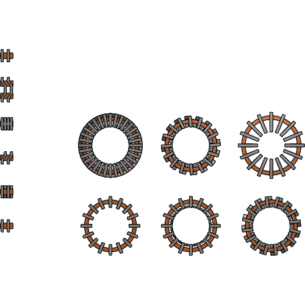
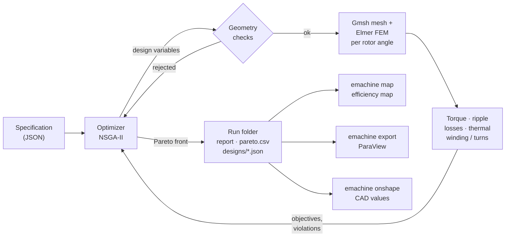

# emachine

**Design, finite-element analysis and multi-objective optimization of electrical machines.**

You describe a motor in a short JSON file: its envelope, requirements, limits and objectives.
emachine searches the design space with NSGA-II and analyses every candidate with finite elements
(Gmsh + Elmer FEM), including losses, a thermal network and the winding. It returns the trade-off
designs, which you can then turn into efficiency maps, ParaView field plots and Onshape CAD.

A machine is a **flux path** (transverse `tfm`, radial `rfm`, axial `afm`, radial-axial `rafm`), a
**torque principle** (`pmsm`, `synrm`, `srm`, `vernier`) and a **rotor layout** (`surface`, `halbach`,
`spoke`, `interior`, ...). The transverse flux PM machine is complete and validated against
published prototypes. The radial flux surface PM machine and a radial-axial hybrid can be solved
with the same commands. The other machines are specified and are being added
(`emachine list`, [docs/machines.md](docs/machines.md)).



## Pipeline



The detailed chart, with the cache, staged evaluation and the post-processing paths, is in
[docs/usage.md](docs/usage.md#2-the-pipeline).

## Quick start

Requires [pixi](https://pixi.sh). It installs Python, Gmsh and the build toolchain, then builds
Elmer FEM from source into the project environment. Elmer is not packaged on conda-forge or PyPI.

```bash
git clone <this repository> emachine && cd emachine
pixi install                 # environment with emachine (editable), numpy, gmsh
pixi run install-elmer       # builds Elmer FEM 26.2.1 into the environment, once (~10-15 min)
pixi run test                # fast tests (~30 s)
```

Optimize a three-phase transverse flux outrunner:

```bash
pixi shell                   # or prefix every command with `pixi run`
emachine optimize --spec examples/tfm_three_phase.json --run runs/opt1 --dry-run   # workflow check, seconds
emachine optimize --spec examples/tfm_three_phase.json --run runs/opt1b             # the real run (~1-2 h)
```

Then look at `runs/opt1b/report.md` and post-process a pick:

```bash
emachine map     --run runs/opt1b                      # torque-speed-efficiency map
emachine export  --run runs/opt1b --sectors 3          # ParaView files and views
emachine onshape --run runs/opt1b                      # values for the Onshape "eMachine" feature
```

**→ [docs/usage.md](docs/usage.md) is the full guide:** every input of the specification, the
command options, the output files, recipes and run-time tips.

## Commands

| Command | Purpose |
|---|---|
| `emachine optimize` | multi-objective optimization of a specification |
| `emachine map` | torque, speed and efficiency map of one design |
| `emachine export` | field export for ParaView with five standard views |
| `emachine compare` | grid of the best designs of several runs (e.g. one per stator type) |
| `emachine onshape` / `featurescript` | values and FeatureScript for the Onshape "eMachine" feature |
| `emachine validate` | validation against a published prototype |
| `emachine study` | multi-topology study on one drive and envelope |
| `emachine mesh` / `check-mesh` / `solve` | low-level: sector mesh and field solution of one parameter file |
| `emachine list` | machines, geometry builders, field solvers and optimizers |

`emachine <command> --help` lists the options. `python -m emachine` works as well.

## Documentation

| Document | Contents |
|---|---|
| [docs/usage.md](docs/usage.md) | **how to optimize a motor architecture**: inputs, options, outputs, pipeline |
| [docs/analysis.md](docs/analysis.md) | supported machines, how the field analysis works, known limits |
| [docs/parameters.md](docs/parameters.md) | design variables and derived dimensions of every machine |
| [docs/naming.md](docs/naming.md), [docs/machines.md](docs/machines.md) | machine names and the machine matrix |
| [docs/architecture.md](docs/architecture.md), [docs/extending.md](docs/extending.md) | code structure; adding a machine, solver or optimizer |
| [docs/design_principles.md](docs/design_principles.md) | variable ranges and ripple methods of the topology catalogue |
| [tickets/](tickets/README.md), [CHANGELOG.md](CHANGELOG.md) | design decisions and history |

## Repository layout

| Path | Contents |
|---|---|
| `emachine/` | the package: `core/` interfaces and registry, `spec/`, `machines/` (one plugin per machine), `physics/`, `solvers/` (Elmer, analytic), `pipeline/`, `optimization/`, `analysis/`, `io/`, `cad/` (Onshape FeatureScript), `cli/` |
| `examples/` | ready-to-run specifications and designs, low-level parameter files, a scripted study, and the validation against published prototypes (`examples/validation/`), each with its command in [examples/README.md](examples/README.md) |
| `tests/` | `unit/`, `tickets/` (acceptance tests), `regression/` (recorded results every change must reproduce) |
| `scripts/install_elmer.sh` | Elmer FEM source build (used by `pixi run install-elmer`) |
| `docs/`, `tickets/` | documentation and design records |

Results are written to `runs/`, which is not tracked by git.

## Tests

```bash
pixi run test          # fast tests, ~30 s
pixi run test-slow     # also Gmsh, Elmer and ParaView runs, ~20 min (EMACHINE_SLOW=1)
pixi run rebaseline    # re-record tests/regression/baseline after an intended model change
```
