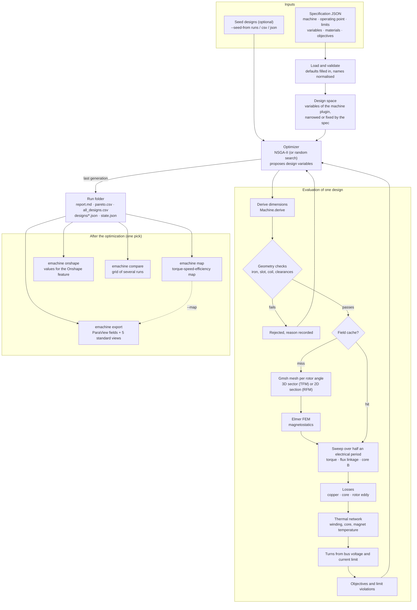

# Optimizing a motor architecture with emachine

This guide covers the main workflow from start to finish. You write a **specification**: the
envelope, the requirements, the limits and what to optimize. `emachine optimize` searches the
design space with finite-element analysis and returns the **trade-off designs**. Follow-up commands
turn a chosen design into an efficiency map, ParaView field plots and Onshape CAD values.

- [1. Install](#1-install)
- [2. The pipeline](#2-the-pipeline)
- [3. Inputs: the specification file](#3-inputs-the-specification-file)
- [4. Options of `emachine optimize`](#4-options-of-emachine-optimize)
- [5. Outputs: the run folder](#5-outputs-the-run-folder)
- [6. After the optimization](#6-after-the-optimization)
- [7. Recipes](#7-recipes)
- [8. Run time and how to keep it down](#8-run-time-and-how-to-keep-it-down)
- [9. Troubleshooting](#9-troubleshooting)

---

## 1. Install

You need [pixi](https://pixi.sh). It provides Python, NumPy, Gmsh, and the compilers needed to
build Elmer FEM. Elmer is not packaged on conda-forge or PyPI, so it is built from source once.

```bash
git clone <this repository> emachine && cd emachine
pixi install                 # Python 3.13, numpy, gmsh; emachine installed in editable mode
pixi run install-elmer       # clones Elmer 26.2.1 and builds it into .pixi/envs/default (~10-15 min, once)
pixi run check-elmer         # prints the ElmerSolver that emachine will use
pixi run install-paraview    # optional: ParaView 6.2 in the environment `paraview` (~1.8 GB)
pixi run test                # fast tests, about 30 s
```

After that, either prefix commands with `pixi run` (`pixi run emachine --help`) or open a shell in
the environment with `pixi shell` and type `emachine ...` directly. The examples below use the
second form.

Supported platforms: macOS (Apple silicon and Intel) and Linux x86-64, where PyPI has Gmsh wheels.
Gmsh comes from PyPI rather than conda-forge on purpose: the recorded results and the test baselines
were made with that build, and conda-forge's build meshes slightly differently. Elmer lives inside
the environment, so run `pixi run install-elmer` again if `.pixi/` is deleted or recreated.

emachine looks for Elmer in this order: `$ELMER_HOME`, the active environment, `ElmerSolver` on
the `PATH`, and `.elmer/install` in the project. An existing Elmer installation can be used by
setting `ELMER_HOME` to its prefix (the folder that contains `bin/ElmerSolver`).

**ParaView** (optional, to look at the field exports; not needed for optimization). `pixi run
install-paraview` installs ParaView 6.2 from conda-forge into a pixi environment of its own
(`.pixi/envs/paraview`), so its Python and Qt stay out of the solver's environment. Then
`pixi run paraview` opens the GUI and `pixi run pvpython ...` renders the view scripts as pictures. On
macOS this needs macOS 14 or later. emachine looks for `pvpython` in this order: `$PVPYTHON`, that
environment, the `PATH`, and a ParaView app in `/Applications`; any ParaView from 5.9 on works (tested
with 6.2).

**Without pixi**, `pip install -e .` installs emachine with NumPy and Gmsh from PyPI. You then
build Elmer yourself (`PREFIX=$HOME/elmer bash scripts/install_elmer.sh`, which needs CMake, a
Fortran compiler and BLAS/LAPACK) and set `ELMER_HOME=$HOME/elmer`.

**Smoke test without Elmer.** `--dry-run` replaces the field solver with a crude analytic
estimate. It exercises the whole workflow in under a second:

```bash
emachine optimize --spec examples/tfm_three_phase.json --run runs/demo --dry-run
```

---

## 2. The pipeline



How one design is evaluated:

1. **Geometry checks** reject impossible designs in microseconds: thin iron, colliding cores, no
   room for the coil. The rejection reason is recorded.
2. **Field analysis.** A mesh is built for each rotor angle (TFM: a periodic 3D sector of one
   phase; RFM: the whole 2D cross-section with all phases). Elmer solves it with a sinusoidal
   current in phase with the induced voltage. The default is 12 rotor positions over half an
   electrical period.
3. **Torque** of the whole machine. A three-phase TFM sums three copies of the phase torque,
   shifted by 120 electrical degrees. Ripple = (highest − lowest) / mean.
4. **Losses** come from the flux density in every element over the cycle: stator core loss
   (alternating and rotational, per harmonic) and eddy-current loss in rotor iron, housing and
   magnets.
5. **Thermal network.** Gives winding, core and magnet temperatures. Copper loss is evaluated at
   the winding temperature.
6. **Turns.** The number of turns is chosen so that the peak current stays under the current
   cut-off and the voltage under the bus maximum. If no turn count satisfies both, the design is
   rejected.
7. **Limits.** Designs over the torque-ripple, temperature or current-density limits are
   infeasible. The optimizer ranks feasible designs first, then the others by how far they miss.

---

## 3. Inputs: the specification file

A specification is a JSON file. **Every key has a default, so a file contains only the values
that differ.** Unknown keys are rejected with a message that names them. To see every key with
its default:

```bash
python -c "import json, emachine.spec as s; print(json.dumps(s.load_spec({}), indent=2))"
```

The examples in [`examples/`](../examples) are good starting points ([examples/README.md](../examples/README.md) has the command for each):

| File | Machine |
|---|---|
| `examples/tfm_three_phase.json` | transverse flux PM outrunner, 3 phases in 29 mm, Halbach rotor, U-core with I-bridge, strip coil |
| `examples/tfm_single_phase.json` | the same machine with one phase (regression case; ripple limit off) |
| `examples/three_phase_{u,ui,cp}[_24].json` | TFM with U-core, UI-core and claw-pole stators (stator comparison) |
| `examples/user_tr48.json` | 48-pole toothed-ring TFM outrunner with every variable fixed (analyse one machine) |
| `examples/rfm_spm_12s10p.json` | radial flux surface PM machine, 12 slots, 10 poles, 100 mm |
| `examples/rafm_zhang2023.json` | radial-axial hybrid PMSM (Zhang et al. 2023) |

Units are in the key names: `_mm`, `_deg` (mechanical), `_el_deg` (electrical), `_A_mm2`, `_C`,
`_T`, `_W_m2K`. A range is written `[min, max]`.

### 3.1 `machine`: the architecture and the envelope

The architecture is chosen by three names (see [naming.md](naming.md)). The machine matrix and
what can be solved today are listed by `emachine list` and in [machines.md](machines.md).

| Key | Default | Options / meaning |
|---|---|---|
| `flux_path` | `"tfm"` | `tfm` transverse, `rfm` radial, `afm` axial, `rafm` radial-axial hybrid |
| `principle` | `"pmsm"` | `pmsm`, `synrm`, `srm`, `vernier` (solvable today: `tfm/pmsm`, `rfm/pmsm`, `rafm/pmsm`) |
| `rotor` | `"halbach"` | TFM: `halbach`, `surface`, `spoke`, `axial_ring`. RFM: `surface` (solvable), `interior` |
| `rotor_placement` | `"outer"` | `outer` (outrunner) or `inner` |
| `outer_diameter_mm` | 80 | outer diameter of the active parts |
| `bore_diameter_mm` | 10 | shaft, or the free bore inside an inner stator |
| `stack_length_mm` | 23 | RFM: lamination stack. TFM: all phases including their spacing |
| `air_gap_mm` | 0.5 | mechanical air gap |
| `phases` | 1 | TFM: 1 or 3 (a ripple limit of 20 % needs 3). RFM: 3 |
| `slots` | – | RFM and AFM: number of stator slots |

Options of the transverse flux machine (TFM):

| Key | Default | Options / meaning |
|---|---|---|
| `stator` | `"ui_core"` | `u_core`, `ui_core` (U-core with I-bridge), `claw_pole`, `toothed_ring`. `c_core`, `e_core`, `z_core` are geometry only |
| `phase_spacing_mm` | 2 | axial gap between neighbouring phases |
| `pole_shift_el_deg` | 0 | offset of every second stator core. 30 cancels the 6th torque harmonic; doubles the model size |
| `ring_arched_valleys`, `ring_staggered_teeth`, `ring_tooth_tips` | false | toothed-ring variants (T26, T27, T73) |
| `rotor_magnet_slots` | false | magnets in two pockets over the side walls (T71) |
| `halbach_segments` | 2 | Halbach segments per pole |
| `rotor_skew_el_deg`, `rotor_skew_steps` | 0, 1 | step skew of the rotor inside each phase (T72) |

### 3.2 `operating_point`

| Key | Default | Meaning |
|---|---|---|
| `speed_rpm` | 300 | speed at which losses, efficiency and voltage are evaluated |
| `ambient_C` | 25 | ambient temperature for the thermal network |
| `current_angle_deg` | 0 | current advance from the induced voltage (0 = in phase; reluctance machines gain from more) |

### 3.3 `limits`: what makes a design feasible

| Key | Default | Meaning |
|---|---|---|
| `iron_thickness_mm` | [2, 10] | allowed range of every iron section |
| `pole_pairs` | [4, 32] | range of pole pairs searched |
| `bus_voltage_V` | [12, 48] | the voltage needed at `speed_rpm` must fit under the maximum |
| `max_current_A` | 15 | peak phase current cut-off; sets the number of turns |
| `max_winding_temp_C` | 120 | from the thermal network |
| `max_magnet_temp_C` | 80 | from the thermal network |
| `max_current_density_A_mm2` | 10 | RMS current density in the copper |
| `max_torque_ripple_percent` | 20 | `null` switches the limit off |
| `max_core_flux_density_T` | null | optional limit on the flux density of 95 % of the core |
| `min_slot_width_mm`, `min_coil_height_mm`, `min_core_gap_mm` | 3, 2, 0.5 | manufacturability |

### 3.4 `variables`: the design space

Every machine defines its own design variables, with default ranges taken from the envelope and
the limits. They are listed with units and meaning in [parameters.md](parameters.md) and printed in
the "Design variables" table of every `report.md`. In the spec you can **narrow** a range or
**fix** a value:

```jsonc
"variables": {
  "leg_width_mm": 2.0,                     // fixed
  "magnet_thickness_mm": [1.5, 5.0],       // narrowed
  "current_density_A_mm2": [1.0, 6.0]
}
```

Variables of the TFM PMSM: `pole_pairs`, `tooth_arc_el_deg`, `leg_width_mm`, `slot_height_mm`,
`yoke_height_mm`, `magnet_thickness_mm`, `current_density_A_mm2`, `rotor_iron_mm`,
`bridge_height_mm` (UI-core).
Variables of the RFM surface PMSM: `pole_pairs`, `slot_height_mm`, `slot_width_mm`,
`yoke_height_mm`, `magnet_thickness_mm`, `magnet_arc_el_deg`, `current_density_A_mm2`.

Fixing every variable turns the spec into the description of **one machine**. Use that to
analyse an existing design (`examples/user_tr48.json`).

### 3.5 `objectives`

A list of any of the following (default: the first three). The optimizer returns the Pareto front
over them.

| Objective | Meaning |
|---|---|
| `max_torque` | mean torque at the operating point |
| `min_losses` | total loss: copper + stator core + rotor eddy currents |
| `min_ripple` | torque ripple, (max − min) / mean |
| `max_efficiency` | efficiency at the operating point |

### 3.6 `materials`, `winding`, `thermal`

These are physical data. The defaults are **assumptions** (SOMALOY 500 SMC stator, N42-class
magnets, steel rotor iron, copper). Replace them with data for the grades you use.

- `materials.stator_core`: `mu_r`, `saturation_T` (`null` = linear) or a measured `bh_curve`,
  `density_kg_m3`, and loss coefficients (`k_hysteresis`, `alpha`, `k_eddy`, `k_anomalous`,
  `rotational`).
- `materials.rotor_iron`, `materials.magnet`, `materials.rotor_housing`: permeability,
  saturation, `conductivity_S_m`, and `eddy_width_mm` (lamination or segment width for eddy
  loss; `null` = solid).
- `winding`: `conductor` (`round_wire` or `strip`), `fill_factor` (0.45) / `strip_fill_factor`
  (0.85), `turns` (`null` = chosen per design), RFM `span` (`concentrated`/`distributed`),
  `layers`, `pitch_slots`, `slot_class`.
- `thermal`: heat-transfer coefficients (`h_external_W_m2K`, `h_air_gap_W_m2K`,
  `h_mount_W_m2K`) and insulation data.

### 3.7 `optimizer` and `fidelity`

| Key | Default | Meaning |
|---|---|---|
| `optimizer.algorithm` | `"nsga2"` | `nsga2` or `random` |
| `optimizer.population` | 16 | designs per generation |
| `optimizer.generations` | 8 | total generations (a resumed run continues up to this number) |
| `optimizer.seed` | 1 | random seed: the same seed and spec give the same run |
| `optimizer.jobs` | 6 | rotor positions solved in parallel (set to about your CPU cores) |
| `fidelity.level` | `"fast"` | mesh level: `fast` or `fine` (finer air-gap cells) |
| `fidelity.positions` | 12 | rotor positions per half electrical period |
| `fidelity.staged` | true | solve every second position first and stop designs that already fail by more than `early_stop_margin` (10 %) |
| `fidelity.load_levels` | 0 | 2–5: solve a geometry at a few current densities and interpolate the rest (see section 8) |

### A complete minimal example

```json
{
  "machine": {"rotor_placement": "outer", "stator": "ui_core", "rotor": "halbach",
              "outer_diameter_mm": 80, "stack_length_mm": 29, "phases": 3,
              "phase_spacing_mm": 1, "air_gap_mm": 0.5, "bore_diameter_mm": 20},
  "operating_point": {"speed_rpm": 300},
  "limits": {"bus_voltage_V": [12, 48], "max_current_A": 15, "max_torque_ripple_percent": 20},
  "variables": {"leg_width_mm": 2.0},
  "winding": {"conductor": "strip"},
  "objectives": ["max_torque", "min_losses", "min_ripple"],
  "optimizer": {"population": 16, "generations": 8, "jobs": 6}
}
```

---

## 4. Options of `emachine optimize`

```bash
emachine optimize --spec SPEC --run RUN [options]
```

| Option | Meaning |
|---|---|
| `--spec FILE` | specification (required) |
| `--run DIR` | run folder (required). **If it exists, the run continues** from its `state.json` |
| `--dry-run` | analytic stand-in for the field solver: tests the workflow in seconds; numbers are not for design |
| `--population N`, `--generations N`, `--seed N` | override the `optimizer` section |
| `--seed-from PATH ...` | start from known designs: run folders (their Pareto designs), `.csv` tables or design `.json` files. Seeds are clipped to the current ranges; those failing the geometry checks are dropped. Results are reused from the source run when its spec is the same |
| `--max-seeds N` | most seed designs to evaluate (default: twice the population) |

---

## 5. Outputs: the run folder

| File | Contents |
|---|---|
| `report.md` | **Start here.** The problem, the limits applied, the design variables with their ranges, run statistics, the trade-off table and the picks with every key number |
| `pareto.csv` | the trade-off (Pareto) designs: no design is better than another in every objective. One row per design: the variables, then the results |
| `all_designs.csv` | every evaluated design, with `feasible`, `violation` and `reason` for rejections |
| `designs/<pick>.json` | parameter file of each pick (`best_compromise`, `highest_torque`, `lowest_loss`, plus `highest_efficiency` with the `max_efficiency` objective). Input to `map`, `export`, `onshape`, `solve` |
| `designs/<pick>.onshape.md` | the pick under the field names of the Onshape features |
| `spec.json` | the complete specification of the run, with defaults filled in |
| `seeds.json` | the designs the run started from (with `--seed-from`) |
| `state.json` | optimizer state, used to continue the run |
| `cache/` | field solutions keyed by geometry, mesh, materials and ampere-turns. Changing a limit, the speed, thermal data or objectives and running again reuses them |

The **picks** are: `highest_torque`, `lowest_loss`, and `best_compromise` (the Pareto design
nearest to the ideal point after normalising each objective).

Main result columns of `pareto.csv` and `all_designs.csv`:

| Column | Meaning |
|---|---|
| `torque_Nm` | mean machine torque |
| `loss_W` | total loss (all phases) |
| `ripple_percent` | torque ripple |
| `efficiency`, `output_power_W` | at the operating point |
| `turns`, `peak_current_A`, `bus_voltage_needed_V` | the winding chosen for the design |
| `copper_W_per_phase`, `iron_W_per_phase`, `rotor_W_per_phase` | loss breakdown |
| `winding_C`, `magnet_C` | temperatures from the thermal network |
| `core_b_p95_T` | flux density on 95 % of the core |
| `positions`, `stopped_early`, `interpolated` | how the design was solved |

---

## 6. After the optimization

Every follow-up command takes `--run RUN [--pick NAME]` (default pick: `best_compromise`) and
writes to `RUN/post/<pick>/<analysis>/`. Alternatively, `--spec FILE --design FILE --out DIR`
analyses any design outside a run.

### Efficiency map: `emachine map`

```bash
emachine map --run runs/opt1                       # best compromise
emachine map --run runs/opt1 --pick highest_torque --turns 8
```

Solves the field at 6 load levels and derives every speed from them. Outputs: `efficiency_map.svg`,
`efficiency_map.csv` (speed × torque grid), `envelope.csv` (drive limit and continuous limit),
`map.md` (summary and assumptions), and `efficiency_map.vtu` for ParaView. Options: `--turns N`
(another winding: fewer turns give more speed at more current), `--overload X` (highest load as
a multiple of the current-density limit, default 2), `--max-speed`, `--levels`.

### ParaView fields: `emachine export`

```bash
emachine export --run runs/opt1 --sectors 3 --map runs/opt1/post/best_compromise/map
pixi run pvpython --force-offscreen-rendering runs/opt1/post/best_compromise/paraview/paraview_views.py \
    --export runs/opt1/post/best_compromise/paraview --out runs/opt1/views
```

Solves one electrical period with the fields kept. It writes `machine.pvd` (solid parts over
time), `air.pvd`, `airgap.pvd`, `core_loss.vtu`, `full_motor.vtu`, `waveforms.csv` (torque,
cogging, flux, voltages), `harmonics.csv`, and `summary.md`, which explains each array and the
ParaView steps. In the ParaView GUI (`pixi run paraview`), *View → Python Shell → Run Script →
`open_in_paraview.py`* opens five standard views as tabs: full motor, sector |B|, mesh, torque
waveform, and efficiency map. `--refresh` rewrites the view files of an existing export without
solving again.

### CAD: `emachine onshape`

```bash
emachine featurescript                              # writes emachine/cad/featurescript/emachine_design.fs
emachine onshape --run runs/opt1 --pick best_compromise
```

Paste `emachine_design.fs` into an Onshape Feature Studio, add the **eMachine** feature to a Part
Studio, and type in the values printed by `emachine onshape`.

### Several architectures: `emachine compare`

```bash
emachine compare --runs runs/types --verify --fidelity fine --positions 24
```

Each sub-folder of `runs/types` that holds a run becomes a row block of `runs/types/grid.md`:
highest torque, best compromise and lowest loss. `--verify` solves every pick again directly,
optionally on a finer mesh.

---

## 7. Recipes

**Compare stator types (or rotors, or phase counts) for the same envelope.** Write one spec per
variant, differing only in `machine.stator` (or `rotor`, `phases`, ...). Run each into
`runs/types/<name>`, then run `emachine compare --runs runs/types --verify`.

```bash
for s in u ui cp; do emachine optimize --spec examples/three_phase_$s.json --run runs/types/$s; done
emachine compare --runs runs/types --verify
```

**Refine a promising run.** Continue with more generations (`--generations 16` on the same
`--run`), or start a new run with tighter ranges and `--seed-from runs/opt1`.

**Change a requirement without re-solving.** Edit a limit, the speed or the objectives and seed a
new run from the old one. Field solutions are reused from the cache.

**Analyse one existing machine.** Fix every variable in `variables` and use `map` / `export`
with `--spec` and `--design`:

```bash
emachine map    --spec examples/user_tr48.json --design examples/user_tr48_design.json --out runs/user_tr48/map
emachine export --spec examples/user_tr48.json --design examples/user_tr48_design.json --out runs/user_tr48/paraview --map runs/user_tr48/map
```

**Validate the solver against a published prototype.**

```bash
emachine validate examples/validation/guo2006/case.json --jobs 6
```

---

## 8. Run time and how to keep it down

Almost all the time goes into field solutions:

| Machine | Model | Per design (12 positions, `fast`) |
|---|---|---|
| TFM | 3D periodic sector, Elmer | about 35 s (linear) to 50 s (saturation) |
| RFM | 2D cross-section, Elmer | about 5 s |

The times above are with `optimizer.jobs = 6` rotor positions solved in parallel. A run takes
roughly population × generations × time per design: the default 16 × 8 TFM run takes one to two
hours on a 6-core laptop, an RFM run about ten minutes. Ways to cut it:

- `fidelity.staged` (on by default) stops hopeless designs after half the positions.
- `--dry-run` while setting up a spec.
- Narrow or fix variables you already know.
- `--seed-from` a previous run instead of starting from random designs.
- `fidelity.load_levels` (2–5) solves each geometry at a few current densities and gives the
  optimizer `optimizer.current_steps` extra designs per geometry for free. This pays off only if
  those designs are useful, and it has not been benchmarked in a full optimization.

---

## 9. Troubleshooting

| Symptom | Cause / fix |
|---|---|
| `emachine optimize: Unknown key 'machine.outer_diameter'` | a misspelt key. The message names it; compare with the defaults (section 3) |
| `ElmerSolver failed ... see .../solve.log` | read the named log. If `bin/ElmerSolver` is missing, run `pixi run install-elmer` or set `ELMER_HOME` |
| "No design met every limit" in `report.md` | the limits are too tight for the envelope. Read the `reason` column of `all_designs.csv`, widen the limits, or run more generations |
| Many designs rejected by geometry checks | the ranges in `variables` leave no room. Narrow them to sensible values |
| Ripple values change with mesh level | each rotor position is meshed separately, so small torques carry mesh noise. Verify picks with `compare --verify --fidelity fine` |

Model assumptions and known limits are listed in [analysis.md](analysis.md#known-limits).
